# Git Phoenix

A pixel-art phoenix for this profile that flies over an Arizona desert at sunset. It burns hotter as recent GitHub activity climbs, cools to ash after two quiet weeks, and bursts out of the ash on the day activity returns. The name is a nod to Phoenix, AZ and BASIS Phoenix, and Camelback Mountain sits on the horizon.

## Gallery

Every look the phoenix can take, in light and dark. These use the sample data in `fixtures/`, so the mountains and calendar differ from the live version.

### Stages

| Stage | Light | Dark |
|---|---|---|
| **Ash** | 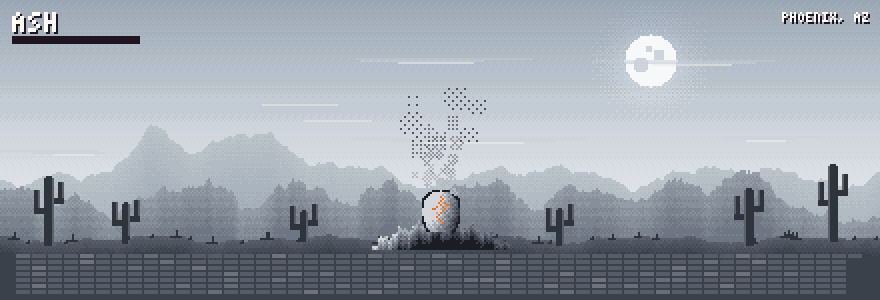 | 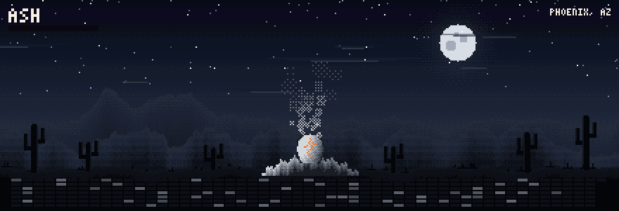 |
| **Ember** | 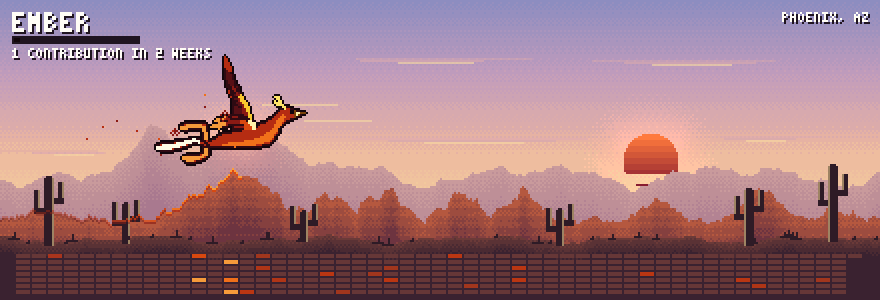 | 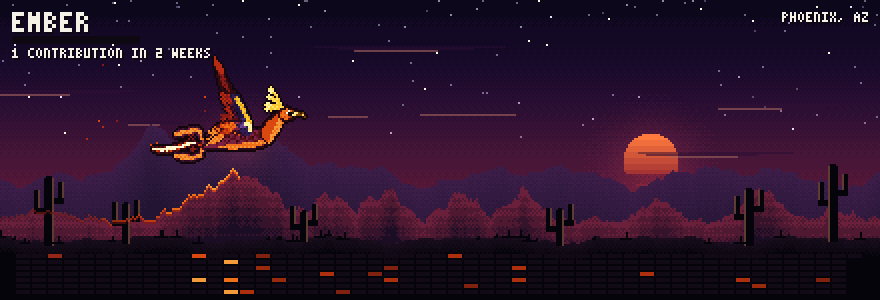 |
| **Kindling** | 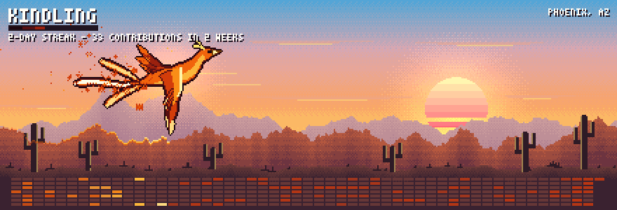 | 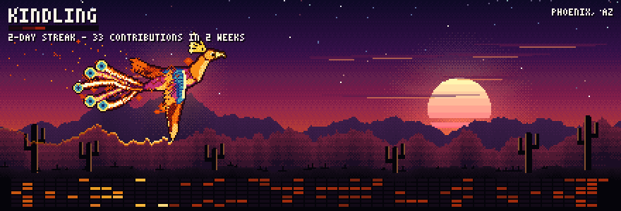 |
| **Blaze** | 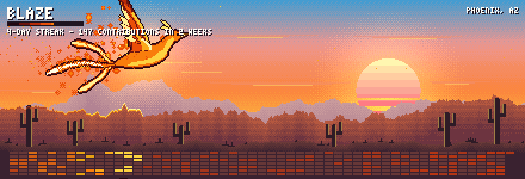 | 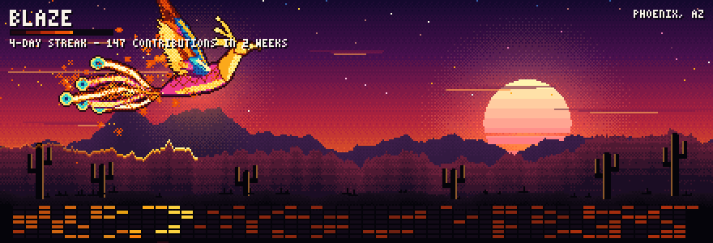 |
| **Inferno** | 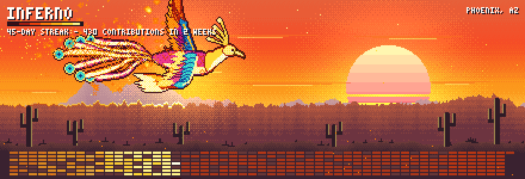 | 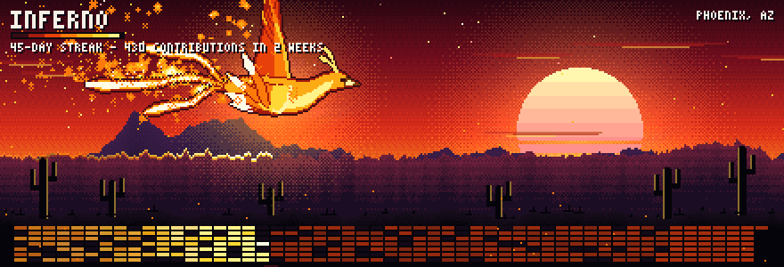 |

### Rebirth

Plays for one day when the phoenix leaves ash. With `enableRebirth` off, that day shows the normal stage instead.

| Light | Dark |
|---|---|
| 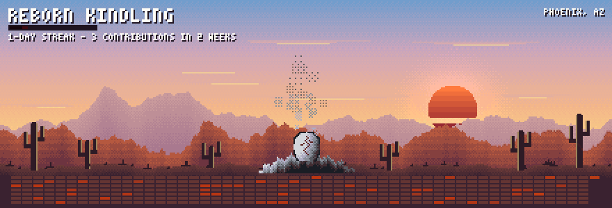 | 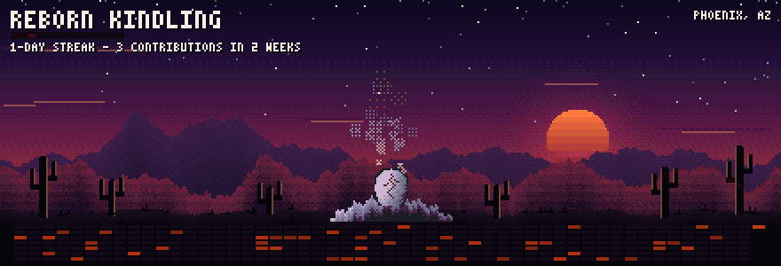 |

### Between stages

Heat is continuous, so a value between two stages blends their looks.

| Heat | Light | Dark |
|---|---|---|
| **0.18**, ember to kindling | 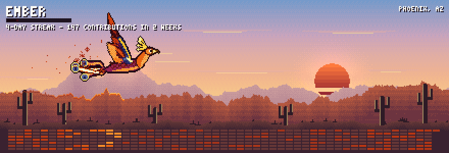 | 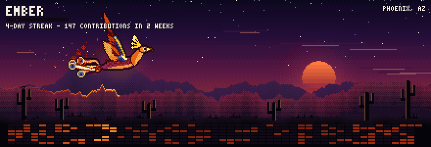 |
| **0.46**, kindling to blaze | 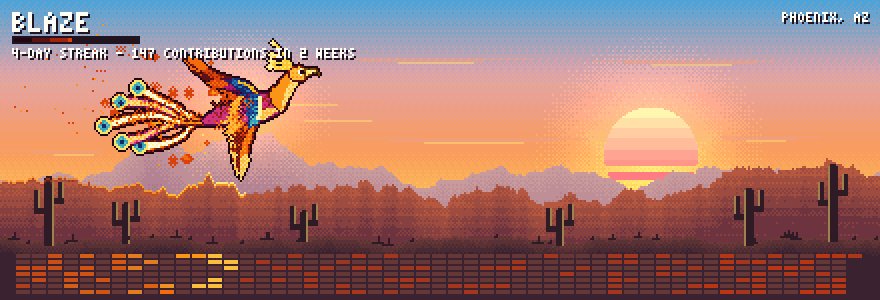 | 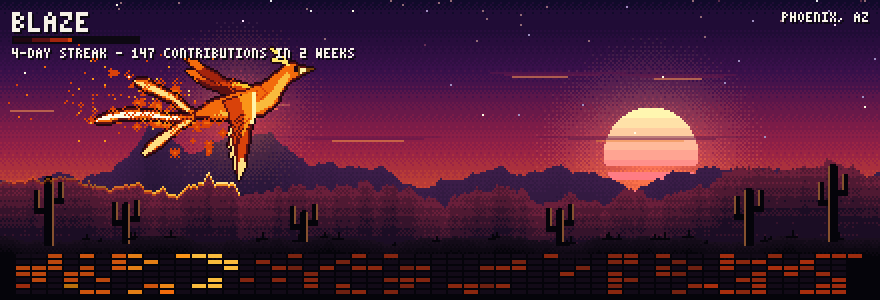 |
| **0.75**, blaze to inferno | 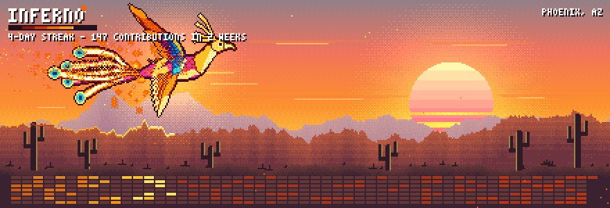 | 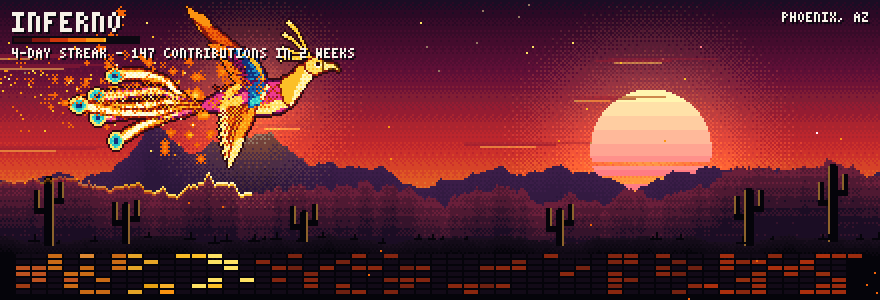 |

### Display options

Shown at blaze. Turning `showCaption` off also removes the tagline.

| Option | Light | Dark |
|---|---|---|
| `showGrid` off | 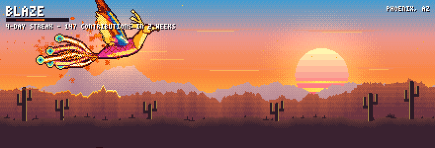 | 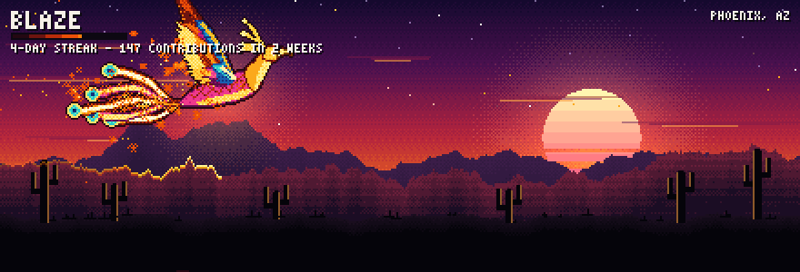 |
| `showCaption` off | 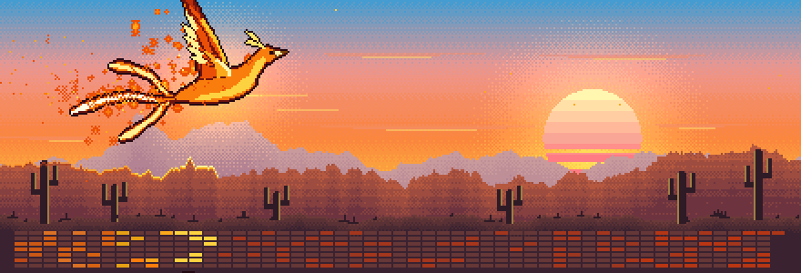 | 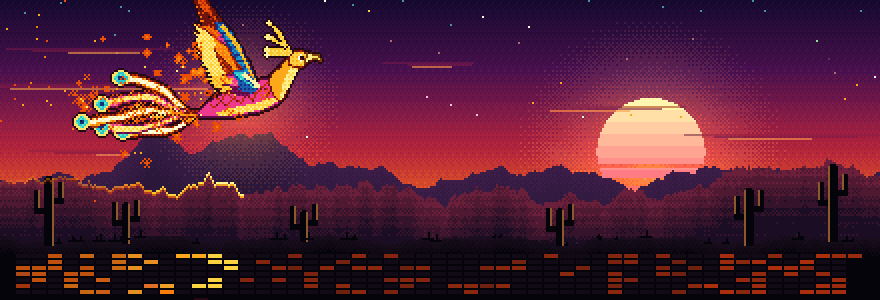 |

## The scene

- **The ridge is your year.** The nearest mountain range has one peak per week of the contribution calendar, so a busy stretch is a tall range and a quiet month is a valley.
- **The ground is your calendar.** Each cell is a day. As the phoenix passes overhead, the ridge line and that week's cells ignite, brighter for bigger days, then fade.
- **The sky is your heat.** Cold dusk at ember, a burning sunset at blaze, a red sky and a huge sun at inferno. Ash gets a cold night with a moon.
- **The theme picks the hour.** Dark mode gets nightfall with stars. Light mode gets golden hour with a bright sky.

## How the phoenix moves

The wings are posed in 3D and projected, so a flap reads as flight: spread on the upstroke, swept under the body on the downstroke, with the tips lagging behind the shoulders. The tail plumes follow the path the bird actually flew, so they whip through turns. At the top of the heat range it flies a full loop.

Every moving part is a function of time wrapped to the loop length, so the last frame runs straight into the first.

## Setup

1. Set two repository variables so the commit on the `output` branch carries your name:

   ```sh
   gh variable set PHOENIX_COMMIT_NAME --body "Your Name"
   gh variable set PHOENIX_COMMIT_EMAIL --body "you@example.com"
   ```

2. In the repository settings under Actions > General, allow workflows to have read and write permissions if your account restricts them. The workflow already asks for `contents: write`.
3. Turn on "Include private contributions on my profile" in your GitHub profile settings if you want private work counted.
4. Run the workflow once from the Actions tab, or push to `main`. It creates the `output` branch that holds the GIFs.

The workflow prints the metrics and heat in its log. Compare them with your profile to confirm the token sees everything. If private contributions are missing, add a `PHOENIX_TOKEN` secret with the `read:user` scope.

## Adding it to the profile

The phoenix isn't on the profile yet. To show it, paste this into the root `README.md`, in place of the `---` above Selected Projects:

```html
<p align="center">
  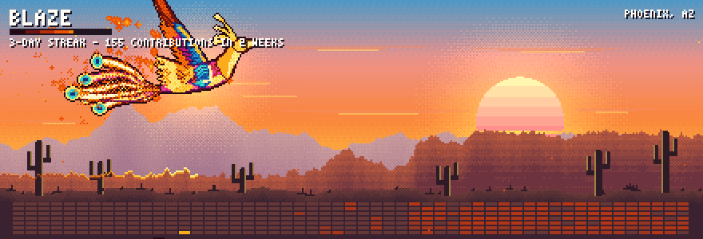
  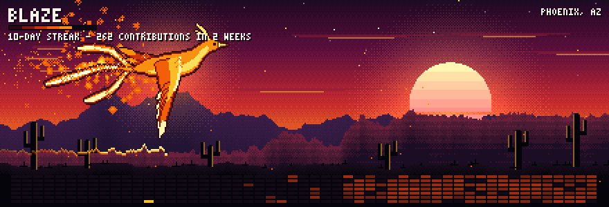
</p>
```

## Heat

```
recentScore      = min(1, log1p(recent14) / log1p(300))
momentumScore    = min(1, log1p(recent60) / log1p(1200))
streakScore      = min(1, currentStreak / 30)
consistencyScore = activeDaysRatio

heat = 0.40*recentScore + 0.20*momentumScore + 0.25*streakScore + 0.15*consistencyScore
```

If the last contribution was more than 3 days ago, heat is multiplied by `max(0, 1 - (daysSinceLast - 3) / 11)`, so it reaches 0 after 14 quiet days. A quiet today doesn't break a streak that ran through yesterday.

The caps of 300 and 1,200 are deliberately high. With caps of 60 and 200, a busy profile sat at the maximum on both activity scores, and only the streak could change the phoenix.

Counts come from the GitHub contribution calendar, so they include PRs, issues, and reviews as well as commits.

## Stages

| Stage | Heat | Look |
|---|---|---|
| Ash | 0 | no flight, a cracked egg in an ash pile, a pulsing ember, slow smoke, a cold moon |
| Ember | under 0.20 | thin and dark red, slow heavy wingbeats, low flight, a few sparks |
| Kindling | 0.20 to 0.45 | deep orange with plum and turquoise plumage, a modest flame tail |
| Blaze | 0.45 to 0.75 | orange-gold with magenta and turquoise, a thick fire trail, a livelier path |
| Inferno | 0.75 and up | near-white core, fast wingbeats, a full loop, embers raining across the scene |

Stages are labels and color anchors. Color, size, tail length, wingbeat speed, fire, and flight height all change continuously with heat.

The ash caption carries no numbers, so a quiet stretch doesn't advertise "0 commits".

## Rebirth

`state.json` on the `output` branch stores the last stage and date. When the stored stage is ash and today's is not, today is saved as `rebirth_date`. That day's loop opens with the egg glowing, the pile exploding, and the phoenix climbing out of the flames before it flies. Storing the date means a second run on the same day still shows the rebirth instead of cancelling it. The next day it's gone.

## Tuning

Everything lives in `phoenix.config.json`:

| Key | Purpose |
|---|---|
| `username` | account to read when `--user` isn't passed |
| `heat.weights` | the four weights in the formula |
| `heat.caps` | `recent14`, `recent60`, and `streakDays` |
| `heat.cooling` | `graceDays` before cooling starts, `fadeDays` until heat reaches 0 |
| `showGrid` | the calendar on the ground |
| `showCaption` | the stage name, heat bar, stats, and tagline |
| `enableRebirth` | the rebirth sequence |
| `tagline` | small text in the top right, empty to remove it |
| `width`, `height` | GIF size in pixels, drawn at half size and doubled |
| `colors` | per-stage fire ramps: eight hex colors from dark to hot, for example `{"blaze": ["#240812", ...]}` |

Stage thresholds are in `heat.py`. Flight, flap, and fire ranges are in `look_for` in `bird.py`. Sky and land colors are at the top of `scene.py`.

## Running it

Python 3.10 or newer, plus numpy and Pillow.

```sh
pip install -r phoenix/requirements.txt

# live data (needs GITHUB_TOKEN)
python phoenix/generate.py --user vignesh-nagarajan-vn --out dist/

# offline: ash, ember, kindling, blaze, inferno, or rebirth
python phoenix/generate.py --sample blaze --out dist/

# re-render the gallery in preview/ after changing the art, about five minutes
python phoenix/generate.py --preview

# tests
python -m unittest discover -s phoenix/tests
```

Each run writes `phoenix-light.gif` and `phoenix-dark.gif`.

## Automation

`.github/workflows/phoenix.yml` runs daily at 06:23 UTC, on manual dispatch, and on every push to `main`. It runs the tests, renders from live data, and force-pushes a single commit with the GIFs and `state.json` to the `output` branch under your name. Keeping one commit stops a megabyte or two a day from piling up in git history. Commits on `output` don't count as contributions, because GitHub only counts the default branch, so regenerating doesn't raise your own heat.

## Files

| Path | Purpose |
|---|---|
| `heat.py` | metrics, heat score, stage choice, rebirth state |
| `source.py` | GitHub GraphQL fetch and fixture loading |
| `pixelart.py` | color ramps, ordered dithering, the 3x5 font |
| `scene.py` | sky, sun, mountains, the data ridge, saguaros, the ash pile |
| `bird.py` | flight paths and the articulated phoenix |
| `render.py` | particles, compositing, the caption, GIF encoding |
| `generate.py` | command line entry point |
| `phoenix.config.json` | weights, caps, toggles, dimensions, colors |
| `fixtures/` | one year of sample data per stage, plus rebirth |
| `preview/` | the gallery GIFs, written by `--preview` |
| `preview.html` | local page that shows the gallery side by side |
| `tests/` | unit tests, including checks that the bird really crosses the frame |
